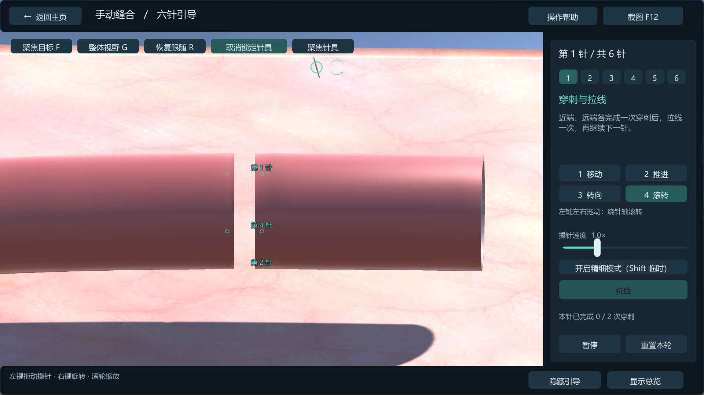
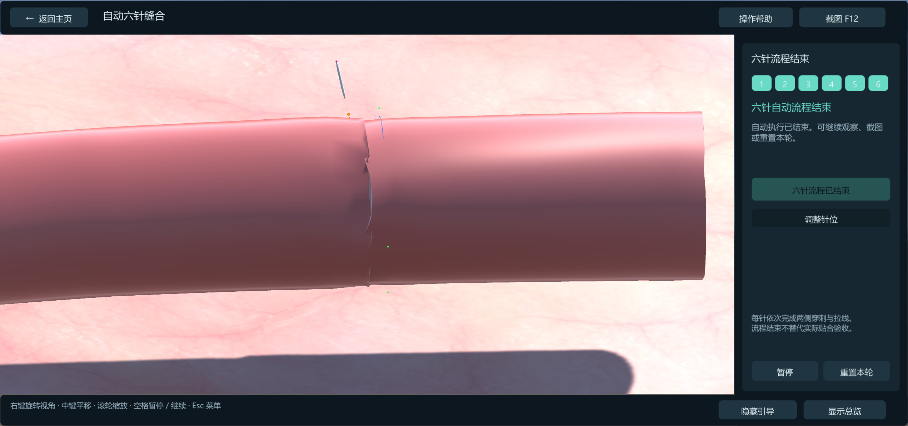
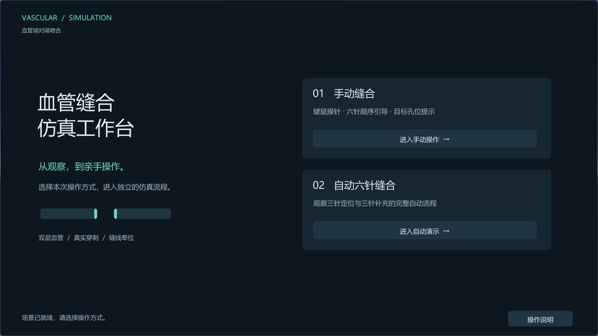

# 基于 XPBD 的血管缝合仿真

以 **扩展位置动力学（Extended Position-Based Dynamics，XPBD）** 为核心，在统一粒子系统中求解血管壁的拉伸、弯曲与层间耦合，并将针具接触、穿刺孔道和缝线牵拉接入组织变形过程。工程使用 **Unity 2022.3**，当前演示场景为血管端对端吻合，支持手动操针与自动六针缝合。

## 自动缝合演示

完整演示约 **3 分 36 秒**，展示三针定位、三针补充及逐针穿刺与牵拉过程。

https://github.com/user-attachments/assets/192375e6-eed2-4ae5-8ff9-4502b76dd0de

点击上方播放器观看完整演示，也可[下载 1080p 视频](docs/videos/automatic-suturing.mp4?raw=true)。

## 血管建模仿真方法：

血管壁由内外两层三角网格离散。两层粒子共同参与约束迭代，面内约束描述各层形变，跨层约束传递载荷并维持壁厚，接触与缝合约束将器械操作转化为组织位移。

### 1. 离散状态与时间推进

将 N 个粒子的位置与速度分别堆叠为以下向量：

$$
\mathbf{x}\in\mathbb{R}^{3N},
\qquad
\mathbf{v}\in\mathbb{R}^{3N}.
$$

质量矩阵与逆质量定义为：

$$
\mathbf{M}=\mathrm{diag}(m_{1}\mathbf{I}_{3},\ldots,m_{N}\mathbf{I}_{3}),
\qquad
w_{i}=\begin{cases}1/m_{i},&\text{自由粒子},\\0,&\text{固定粒子}.\end{cases}
$$

记一个求解步的时长为 h，时间步编号为 n。外力作用下的基本位置预测为：

$$
\widetilde{\mathbf{x}}
=\mathbf{x}^{n}+h\mathbf{v}^{n}+h^{2}\mathbf{M}^{-1}\mathbf{f}_{\mathrm{ext}}.
$$

工程在预测阶段加入重力、外场的表面法向分量和速度阻尼。随后以预测位置为初值，通过约束修正得到下一步位置，再重建速度：

$$
\mathbf{x}^{(0)}=\widetilde{\mathbf{x}},
\qquad
\mathbf{v}^{n+1}=\frac{\mathbf{x}^{n+1}-\mathbf{x}^{n}}{h}.
$$

这里圆括号上标表示同一时间步内的迭代编号，避免与时间步上标混用。

### 2. 弹性能量、柔度与隐式离散

XPBD 用几何约束描述局部形变，以柔度调节其弹性响应。以 C 表示约束函数，α 表示柔度，下标 j 标记约束。对正柔度的独立标量约束，能量与弹性力写作：

$$
U(\mathbf{x})=\sum_{j}\frac{C_{j}(\mathbf{x})^{2}}{2\alpha_{j}},
\qquad
\mathbf{f}_{\mathrm{elastic}}=-\nabla_{\mathbf{x}}U(\mathbf{x}).
$$

对于线性伸长约束，柔度是相应弹簧刚度的倒数；柔度越小，抵抗该类形变的能力越强。零柔度通过约束方程的极限形式表示硬约束。不同几何约束具有各自的量纲和参数尺度。

将惯性与弹性放在同一隐式时间步中，可写成位置空间的增量势能：

$$
\Phi(\mathbf{x})=
\frac{1}{2h^{2}}
(\mathbf{x}-\widetilde{\mathbf{x}})^{\mathsf{T}}
\mathbf{M}(\mathbf{x}-\widetilde{\mathbf{x}})
+U(\mathbf{x}).
$$

第一项衡量位置偏离自由预测的程度，第二项衡量组织形变。引入约束乘子和时间步缩放后的柔度，可以把驻点条件改写为：

$$
\begin{aligned}
\mathbf{M}(\mathbf{x}-\widetilde{\mathbf{x}})-\mathbf{J}^{\mathsf{T}}\boldsymbol{\lambda}&=\mathbf{0},\\
\mathbf{C}(\mathbf{x})+\widetilde{\boldsymbol{\alpha}}\boldsymbol{\lambda}&=\mathbf{0},\\
\widetilde{\alpha}_{j}&=\alpha_{j}/h^{2}.
\end{aligned}
$$

其中 J 是约束对粒子位置的雅可比矩阵，每一行对应一个约束梯度。这里将时间步统一记作 h。

### 3. 从线性化到局部 XPBD 更新

在当前迭代位置重新计算约束与梯度，采用 XPBD 的局部线性化，可得到乘子增量的约化系统：

$$
\left(\mathbf{J}\mathbf{M}^{-1}\mathbf{J}^{\mathsf{T}}
+\widetilde{\boldsymbol{\alpha}}\right)\Delta\boldsymbol{\lambda}
=-\mathbf{C}(\mathbf{x})-\widetilde{\boldsymbol{\alpha}}\boldsymbol{\lambda}.
$$

按约束逐个更新时，这个系统化为标量运算。对第 j 个约束，第 k 次迭代为：

$$
\Delta\lambda_{j}=
\frac{-C_{j}(\mathbf{x}^{(k)})-\widetilde{\alpha}_{j}\lambda_{j}^{(k)}}
{\displaystyle\sum_{i}w_{i}
\left\lVert\nabla_{\mathbf{x}_{i}}C_{j}(\mathbf{x}^{(k)})\right\rVert^{2}
+\widetilde{\alpha}_{j}}.
$$

$$
\begin{aligned}
\Delta\mathbf{x}_{i}&=w_{i}\nabla_{\mathbf{x}_{i}}C_{j}\,\Delta\lambda_{j},\\
\mathbf{x}_{i}&\leftarrow\mathbf{x}_{i}+\Delta\mathbf{x}_{i},\\
\lambda_{j}&\leftarrow\lambda_{j}+\Delta\lambda_{j}.
\end{aligned}
$$

分母结合有效逆质量与柔度，分子同时考虑几何误差和本步累计乘子。乘子在同一求解步的迭代间保留，使柔度直接参与平衡关系。标准 XPBD 在新时间步初始化乘子；固定粒子的零逆质量使其保持位置，并将修正分配给其他自由粒子。

当柔度为零时，该更新回到硬约束的位置投影。有限迭代下的误差仍由约束耦合、求解顺序和迭代预算共同决定；柔度用于设定弹性，迭代次数用于改善求解收敛。

### 4. 面内拉伸约束

对同层相邻粒子 a、b，以初始边长为参考，定义边长约束、单位方向及约束梯度：

$$
\begin{aligned}
C_{\mathrm{d}}(\mathbf{x})
&=\left\lVert\mathbf{x}_{a}-\mathbf{x}_{b}\right\rVert-\ell_{ab}^{0},\\
\mathbf{n}_{ab}
&=\frac{\mathbf{x}_{a}-\mathbf{x}_{b}}
{\left\lVert\mathbf{x}_{a}-\mathbf{x}_{b}\right\rVert},\\
\nabla_{\mathbf{x}_{a}}C_{\mathrm{d}}&=\mathbf{n}_{ab},\qquad
\nabla_{\mathbf{x}_{b}}C_{\mathrm{d}}=-\mathbf{n}_{ab}.
\end{aligned}
$$

式中，ℓ 表示边长，上标 0 表示初始值，下标 ab 标记粒子对。单位梯度使分母简化，得到边长约束的显式局部更新：

$$
\begin{aligned}
\Delta\lambda_{\mathrm{d}}
&=\frac{-C_{\mathrm{d}}-\widetilde{\alpha}_{\mathrm{d}}\lambda_{\mathrm{d}}}
{w_{a}+w_{b}+\widetilde{\alpha}_{\mathrm{d}}},\\
\Delta\mathbf{x}_{a}&=w_{a}\mathbf{n}_{ab}\Delta\lambda_{\mathrm{d}},\qquad
\Delta\mathbf{x}_{b}=-w_{b}\mathbf{n}_{ab}\Delta\lambda_{\mathrm{d}}.
\end{aligned}
$$

内壁和外壁分别建立面内边约束。局部柔度分布控制不同区域对拉伸的响应，网格中的多条边共同传递针具与缝线产生的位移。

### 5. 弯曲约束

相邻三角面共享一条边，其单位法线分别记为 n₁、n₂。弯曲由当前二面角相对参考角度的偏差描述：

$$
\theta=\arccos\!\left(\mathrm{clamp}
(\mathbf{n}_{1}\cdot\mathbf{n}_{2},-1,1)\right),
\qquad
C_{\mathrm{b}}=\theta-\theta_{0}.
$$

其中 clamp 将输入截断到区间 [−1, 1]，以避免浮点误差使反余弦输入越界。

约束涉及共享边及两个对顶点，共四个粒子。将二面角梯度代入同一 XPBD 更新即可分配弯曲修正。面内距离控制伸长，二面角控制曲率变化，二者使用各自的柔度与乘子。

### 6. 双层耦合与壁厚保持

内外壁通过对应粒子及跨层连接建立耦合。对一组对应点，以下标 o、i 分别标记外壁与内壁位置，以 h₀ 表示参考间距。厚度约束及跨层单位方向为：

$$
C_{\mathrm{h}}=
\left\lVert\mathbf{x}_{\mathrm{o}}-\mathbf{x}_{\mathrm{i}}\right\rVert-h_{0},
\qquad
\mathbf{n}_{\mathrm{h}}=
\frac{\mathbf{x}_{\mathrm{o}}-\mathbf{x}_{\mathrm{i}}}
{\left\lVert\mathbf{x}_{\mathrm{o}}-\mathbf{x}_{\mathrm{i}}\right\rVert}.
$$

$$
\begin{aligned}
\Delta\lambda_{\mathrm{h}}
&=\frac{-C_{\mathrm{h}}-\widetilde{\alpha}_{\mathrm{h}}\lambda_{\mathrm{h}}}
{w_{\mathrm{o}}+w_{\mathrm{i}}+\widetilde{\alpha}_{\mathrm{h}}},\\
\Delta\mathbf{x}_{\mathrm{o}}&=w_{\mathrm{o}}\mathbf{n}_{\mathrm{h}}\Delta\lambda_{\mathrm{h}},\\
\Delta\mathbf{x}_{\mathrm{i}}&=-w_{\mathrm{i}}\mathbf{n}_{\mathrm{h}}\Delta\lambda_{\mathrm{h}}.
\end{aligned}
$$

跨层连接把一侧壁面的位移传递到另一侧；跨层柔度决定壁厚方向允许的相对形变。层间分离与局部防翻转约束进一步维持两层的几何次序。面内拉伸、弯曲和厚度在同一迭代中共同作用，形成双层组织的整体响应。

### 7. 接触与穿刺

局部接触可用单边间隙约束表示。接触面点、朝向允许区域的单位法线及安全间距分别记为：

$$
\mathbf{p}_{\mathrm{c}},
\qquad
\mathbf{n}_{\mathrm{c}},
\qquad
d_{\min}.
$$

允许区域满足以下间隙条件：

$$
g_{\mathrm{c}}(\mathbf{x}_{i})=
\mathbf{n}_{\mathrm{c}}\cdot(\mathbf{x}_{i}-\mathbf{p}_{\mathrm{c}})-d_{\min}\geq0.
$$

对违反间隙条件的区域施加分离修正，结合针尖局部作用、层间关系和针体位置更新接触状态。穿刺后保存针体穿过内外壁的孔道信息，使后续针体运动和缝线牵拉具有组织中的附着位置。

### 8. 穿刺锚点与缝线牵拉

孔位和参考针位使用材料身份跟随组织。在网格边上，两个端点及插值参数确定锚点：

$$
\mathbf{p}(s,t)=(1-s)\mathbf{x}_{a}(t)+s\mathbf{x}_{b}(t),
\qquad 0\leq s\leq1.
$$

随粒子位置更新即可得到当前锚点。缝线将两侧孔道约束点配对，以 A、B 标记两端，逐步缩短允许距离，使两侧组织收拢：

$$
L^{n+1}=\max\!\left(L_{\mathrm{target}},L^{n}-v_{\mathrm{pull}}h\right),
\qquad
C_{\mathrm{s}}=\left\lVert\mathbf{q}_{B}-\mathbf{q}_{A}\right\rVert-L.
$$

拉紧时沿两端连线分配位置修正，再由附着关系传递到组织粒子；局部接触限制继续牵拉造成的交叠。缝合流程据此串联穿刺、离壁与收拢。

### 9. 参数与数值求解

| 数值量 | 作用 |
| --- | --- |
| 拉伸柔度 | 控制同层边长变化 |
| 弯曲柔度 | 控制局部曲率变化 |
| 跨层柔度 | 控制壁厚方向的相对位移 |
| 粒子质量与固定边界 | 决定惯性及约束修正的分配 |
| 求解步长 | 决定时间离散尺度，并进入柔度缩放 |
| 迭代次数 | 控制耦合约束误差的传播与收敛 |
| 速度阻尼 | 调节运动衰减 |

子步细分与增加同一步内的迭代对应不同的数值过程。若一帧分为 S 个子步，则每次求解使用的子步长为：

$$
h=\frac{\Delta t}{S}.
$$

其中 Δt 为一帧的时长，柔度缩放也应使用该子步长。[Small Steps in Physics Simulation](https://mmacklin.com/smallsteps.pdf) 对比了这两种计算预算分配方式，并展示了较小子步对约束误差与数值耗散的影响。

## 功能与流程

| 模块 | 当前功能 |
| --- | --- |
| 主页与双模式 | Play 后进入主页，分别选择手动或自动流程 |
| 双层血管 | 内外壁共同求解，通过跨层连接维持壁厚与层间关系 |
| 手动操针 | 移动、推进、转向、滚转；针具锁定、速度调节与精细操作 |
| 工具提示 | 十字双向箭头、针轴箭头、转向弧线、滚转环形箭头 |
| 穿刺与孔道 | 记录双层穿刺，维护当前孔道、历史孔道和针体离壁状态 |
| 缝线收拢 | 配对实际孔道，通过拉线约束逐步收拢局部组织 |
| 自动六针 | 三针定位、三针补充，串联穿刺、退出、转移和拉线 |
| 观察与记录 | 旋转、平移、缩放、聚焦、总览、暂停和截图 |

### 手动缝合

进入手动模式后默认选中并锁定针具，通过工具按钮或数字键选择操作，在视图内左键拖动操针。六针参考孔位以青绿圈贴合血管表面显示，随组织变形实时更新。

**流程按实际穿刺事件推进**：独立的完整双层穿刺在针体退出后计数，同一事件记录一次。每累计两次穿刺后开放拉线，收拢达到推进条件后进入下一针。操作者自行安排两侧穿刺位置和进出方向，参考孔位用于观察和定位。

### 自动六针缝合

自动模式先预览六针计划，点击“开始六针缝合”后执行：

1. 选择三个相隔约 120° 的定位针位。
2. 每针依次穿过近端、远端血管壁，退出针体后拉线。
3. 在三个定位针之间各增加一针，完成三针补充缝合。
4. 在组织变形中更新材料锚点，规划针具转移路线，检查穿刺、离壁与拉线状态。

**针位预览 → 移动到进针位置 → 对准针具 → 穿透血管壁 → 确认针体退出 → 转移到另一侧 → 拉线收拢 → 下一针**

## 快速开始

### 环境与启动

- Unity **2022.3.62f3c1**，桌面键鼠操作。
- Unity Package Manager 根据 [manifest.json](Packages/manifest.json) 安装依赖，包括 Collections、Mathematics、uGUI 和 Test Framework。

1. 克隆仓库，在 Unity Hub 中将仓库根目录添加为项目。
2. 打开项目，等待资源导入和脚本编译。
3. 打开主场景：[`Assets/TestScenes/Vessel_PBDTest/SingLayer.unity`](Assets/TestScenes/Vessel_PBDTest/SingLayer.unity)。
4. 点击 Play，在主页选择手动或自动模式。

主页等待选择时保持仿真暂停。自动模式可先预览针位，再点击开始。返回主页或重置本轮会重新加载场景，恢复初始针具、组织与孔道状态。

### 键鼠操作

| 操作 | 按钮或输入 |
| --- | --- |
| 移动 | **1**；左键拖动，在视平面移动；**Q / E** 调整远近 |
| 推进 / 回退 | **2**；沿针尖在屏幕上的朝向拖动推进，反向拖动回退 |
| 转向 | **3**；左键拖动调整针尖朝向 |
| 滚转 | **4**；左键左右拖动，绕针轴旋转 |
| 选中与锁定 | 手动模式默认锁定；同一按钮可取消选中或重新锁定 |
| 聚焦针具 | “聚焦针具”按钮 |
| 操针速度 | 滑条 **0.2×–3.0×**，默认 **1.0×** |
| 精细操作 | 按住 **Shift**，或使用精细模式开关 |
| 相机 | 右键旋转、中键平移、滚轮缩放 |
| 观察范围 | **F** 聚焦参考针位，**G** 查看整体，**R** 恢复跟随 |
| 暂停 / 继续 | **空格**或界面按钮 |
| 帮助与菜单 | “操作帮助”按钮；**Esc** 打开或关闭暂停菜单 |
| 拉线 | 完成两次穿刺后点击“拉线” |
| 截图 | **F12**；仿真视图保存至工程根目录 `PatentScreenshots/` |

## 开发与验证

Unity 内通过 **PBDLearn → Session → Run guidance checks** 运行手动流程与交互规则检查，覆盖完整穿刺、重复事件、任意孔位事件推进、拉线条件、推进方向和表面标记跟随。

自动缝合几何与路线检查位于 [`Tools/Tests/AutoSutureWorkflowAdvanceRegression`](Tools/Tests/AutoSutureWorkflowAdvanceRegression)。迭代验证范围见 [验证记录](docs/validation/suture-session-2026-10-30.md)，详细操作见 [双模式使用说明](docs/SUTURE_SESSION.md)。

## 后续迭代

- 扩展血管侧对侧吻合的几何建模与缝合流程。
- 接入手控器，实现针具位姿与交互输入映射。
- 完成 VR 串流与沉浸式观察、操针交互。
